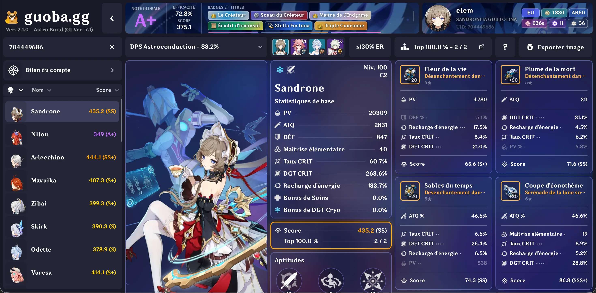
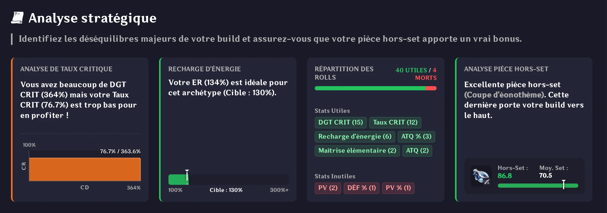
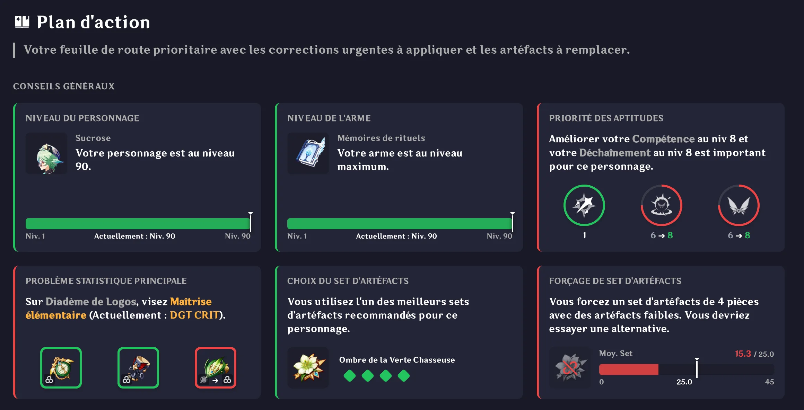
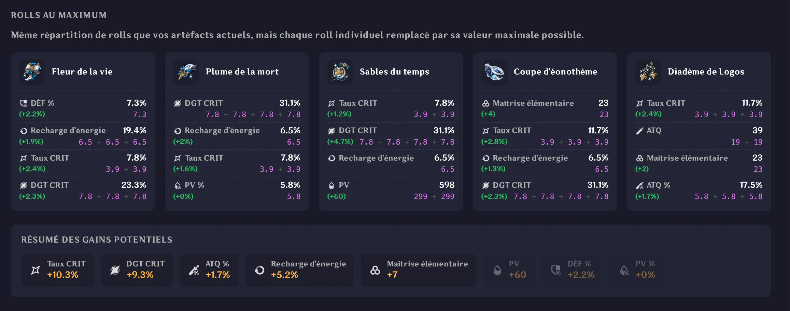
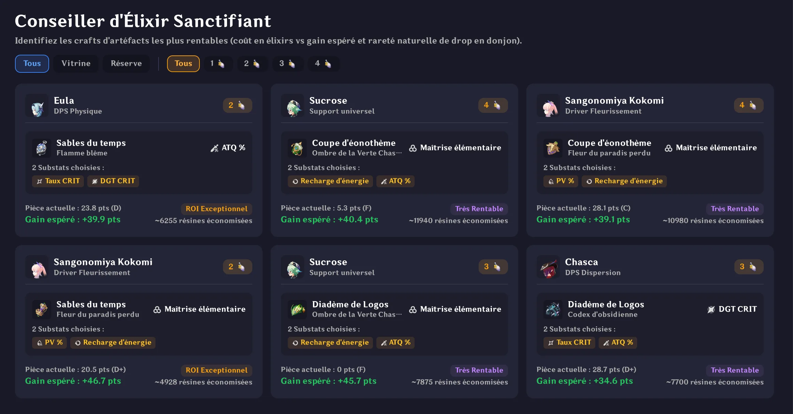
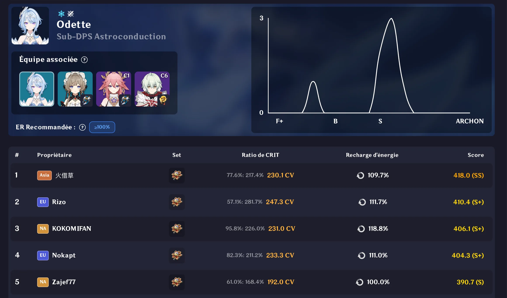

guoba.gg réinvente l'optimisation sur Genshin Impact. Bien plus qu'une simple calculatrice, c'est un véritable coach virtuel : en entrant votre UID, l'outil évalue la qualité mathématique pure de vos équipements via un double système de score et de grade, simule vos statistiques réelles en combat sous buffs, et vous guide pas à pas pour perfectionner votre personnage.

Le projet est né d'une frustration simple : le besoin d'avoir un outil précis, immersif et proactif pour orienter ses choix de farm sans avoir à ouvrir un tableur.

## 01. Stack technique

Pour soutenir une application à la fois ultra-rapide, réactive et inviolable, l'architecture repose sur une stack moderne axée sur la performance à l'edge et l'intégrité absolue des données :

- **Astro (Front-end & Performance) :** Propulse l'intégralité de l'interface utilisateur. En s'appuyant sur du JavaScript vanilla et une empreinte minimale côté client, il garantit des temps de chargement quasi instantanés et une fluidité totale, indispensable pour naviguer sans friction dans des fiches de personnages denses et interactives.
- **Hono (Middleware, Moteur de calcul & Anti-triche) :** Fait office de passerelle ultra-légère entre le front-end et la base de données. Tous les calculs de scores, de formules d'optimisation et d'évaluation des statistiques sous buffs sont réexécutés et validés côté serveur. Cette barrière hermétique certifie la véracité des données et élimine tout risque de triche ou de falsification avant l'inscription aux classements mondiaux.
- **Supabase (Base de données & Authentification) :** Gère la persistance des données relationnelles (PostgreSQL) pour stocker les profils, les configurations de builds et les classements compétitifs globaux. Il prend également en charge l'authentification sécurisée via OAuth Discord, assurant une connexion en un clic parfaitement intégrée aux habitudes de la communauté de joueurs.
- **Cloudflare Pages & Workers (Hébergement Edge & Proxy API Enka) :** Assure le déploiement mondial de la plateforme avec une latence minimale. Les Workers agissent comme un relais stratégique pour interroger, mettre en cache et sécuriser les appels à l'API EnkaNetwork (qui extrait les données publiques en jeu via l'UID), contournant ainsi les limites de requêtes (*rate limits*) tout en garantissant une haute disponibilité.

## 02. Une interface moderne

L'objectif principal de **guoba.gg** est de rendre le theorycrafting (l'optimisation mathématique des personnages en jeu) accessible. Ainsi, l'interface a été pensée pour être la plus user-friendly possible.

Cette dernière se présente comme un dashboard dense mais organisé, permettant aux joueurs d'accéder rapidement aux informations les plus pertinentes pour leurs personnages. Les couleurs, inspirées du jeu original, créent une ambiance immersive tout en maintenant une clarté visuelle.

Contrairement à d'autres sites du genre, **guoba.gg** ne présente pas aux utilisateurs des tableurs ou des graphiques trop complexes. Il agit comme un vrai compagnon de jeu et un vulgarisateur intelligent, incluant aussi de la gamification pour faire de l'interface un espace amusant et ludique.

## 03. Des modules intelligents

L'application regorge d'outils spécialisés conçus pour chaque aspect du jeu — les éléments présentés ci-dessous ne sont d'ailleurs qu'un aperçu parmi une vaste panoplie de fonctionnalités.

Tout le défi d'UI/UX a consisté à bannir les tableurs austères et les pavés d'explications indigestes au profit d'un guidage visuel instantané. Grâce à des jauges intuitives, des contrastes chromatiques marqués et des cartes d'alerte au design soigné, l'interface conduit naturellement le regard vers l'essentiel et avertit avec élégance sur les optimisations à apporter :

- **L'Analyse stratégique :** Révèle en un clin d'œil les déséquilibres du build (ratio critique asymétrique, seuil d'énergie non atteint, décompte des rolls perdus) et évalue la pertinence de la pièce hors-set via des indicateurs graphiques immédiats.
- **Le Plan d'action :** Se présente comme une feuille de route visuelle et hiérarchisée. Il attire l'attention sur les erreurs critiques (statistique principale inadaptée, forçage contre-productif d'un set 4 pièces au détriment des sous-stats) et cible les investissements prioritaires (niveaux d'aptitudes, armes) pour maximiser le potentiel de combat.

Au-delà de l'équipement actuel, l'application intègre un moteur de simulation de potentiel. Dans Genshin Impact, chaque tirage de statistique secondaire comporte une part de variance aléatoire (RNG). 

Ce module décompose chaque jet individuel et simule le plafond théorique absolu des artéfacts possédés par le joueur si chaque roll avait atteint sa valeur maximale. Il permet de mesurer en un coup d'œil la marge de progression restante sur son équipement sans avoir à farmer de nouvelles pièces.

Avec l'arrivée d'outils de craft avancés dans le jeu, les joueurs doivent gérer des ressources extrêmement rares telles que les Élixirs Sanctifiants. Faire le mauvais choix d'artéfact à fabriquer peut coûter plusieurs mois de progression.

Le **Conseiller d'Élixir** intègre un algorithme d'optimisation économique unique : il croise le coût en élixirs, les probabilités naturelles de drop en donjon et le gain d'efficacité attendu sur le personnage. L'outil attribue ainsi un indice de retour sur investissement (ROI) clair, chiffré directement en équivalent de résine et de temps économisés.

## 04. Des classements mondiaux compétitifs et robustes

Pour comparer équitablement les joueurs du monde entier, **guoba.gg** propose des classements compétitifs basés sur des conditions rigoureusement standardisées. Chaque personnage est évalué au sein d'une composition d'équipe de référence selon un archétype prédéfini.

Une courbe de distribution statistique permet à chaque joueur de situer précisément son build au sein de la communauté mondiale, du grade F+ jusqu'au rang prestigieux d'Archon. Sécurisé par la validation anti-triche côté serveur via Hono, ce classement offre une référence fiable, transparente et incontestable pour l'ensemble des serveurs (Europe, Amérique, Asie).

