À l'opposé de la frénésie des coffee shops traditionnels, Lofi Coffee invite au ralentissement. L'enjeu de ce projet était de concevoir une marque fusionnant la chaleur de l'univers du café avec l'esthétique nostalgique et apaisante du mouvement lofi. Plus qu'une simple boisson, c'est un véritable refuge sensoriel.

Pour traduire cette atmosphère, l'identité visuelle mise sur une approche immersive et minimaliste : des teintes douces, des typographies soignées et des textures chaleureuses qui rappellent le confort d'une soirée accompagnée de sa playlist favorite.

L'univers se décline en quatre gammes distinctes (Coffee, Cocoa, Ritual et Atelier). Chacune possède sa propre personnalité, tout en s'intégrant dans un écosystème de marque parfaitement unifié, du design des packagings jusqu'à l'expérience globale. Au final, Lofi Coffee n'est pas seulement un lieu ou un produit. C'est la bande-son de vos rituels quotidiens.

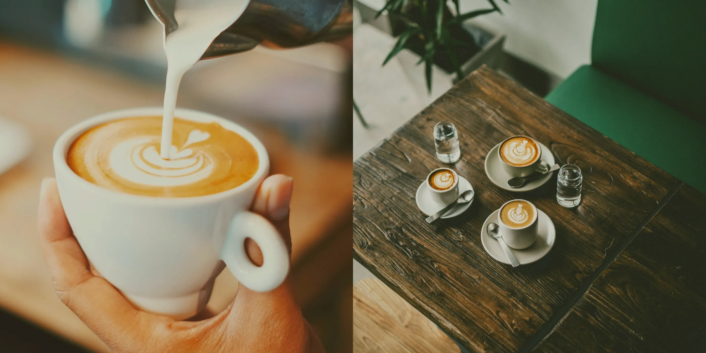

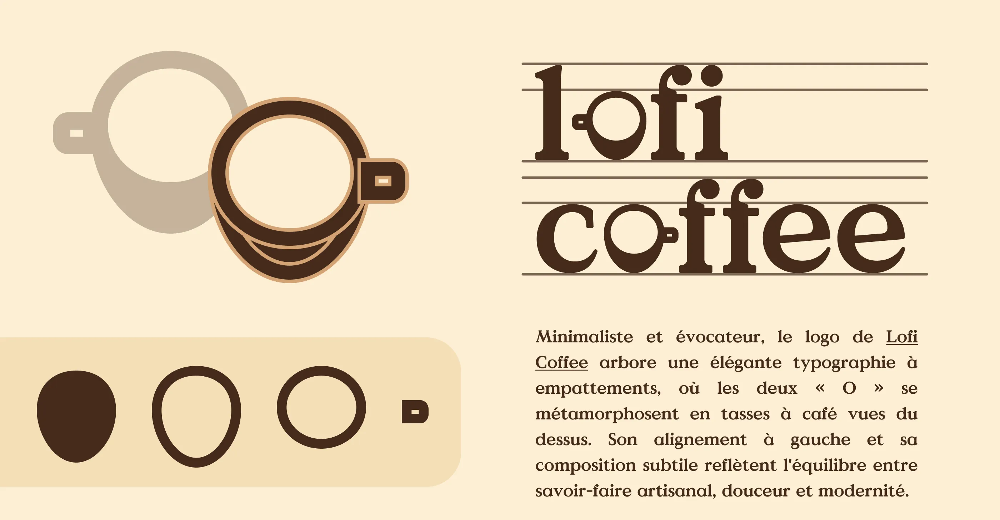

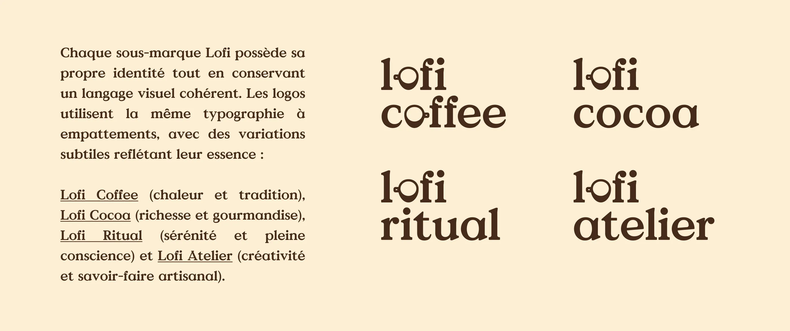

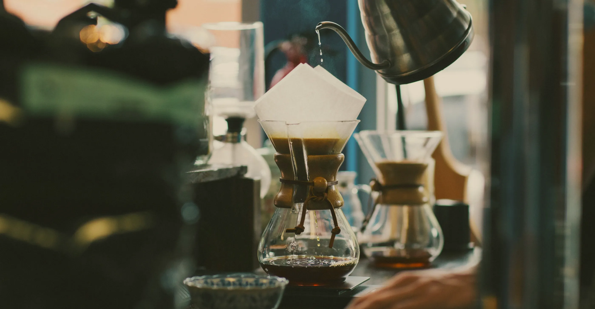

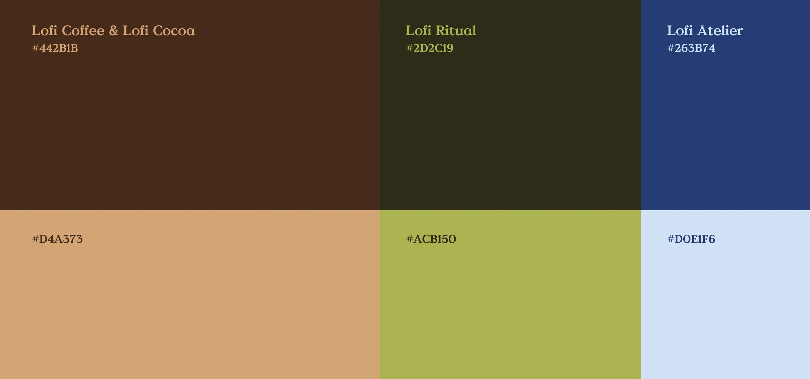

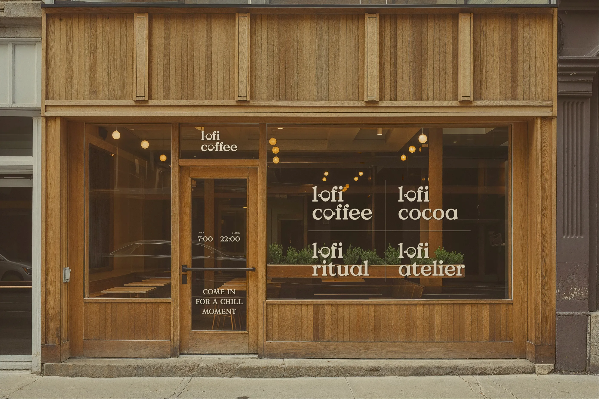

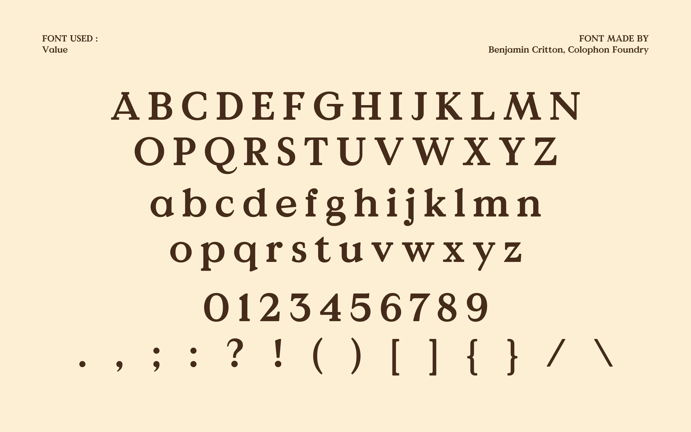

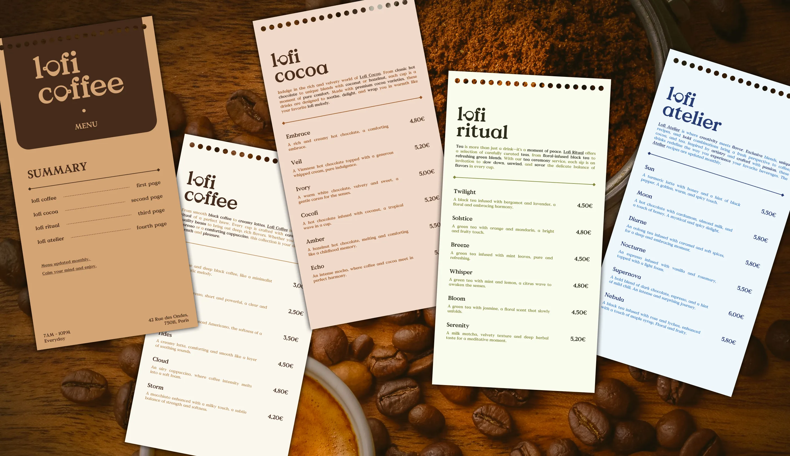

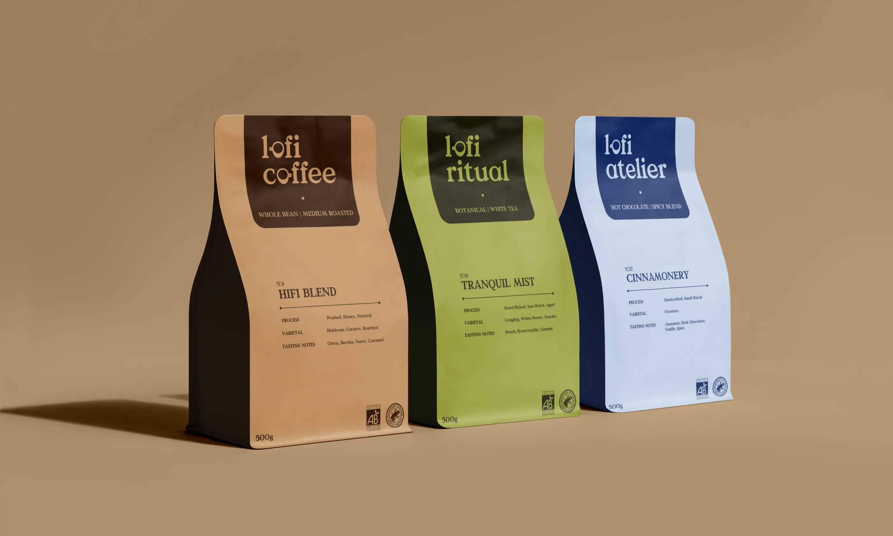

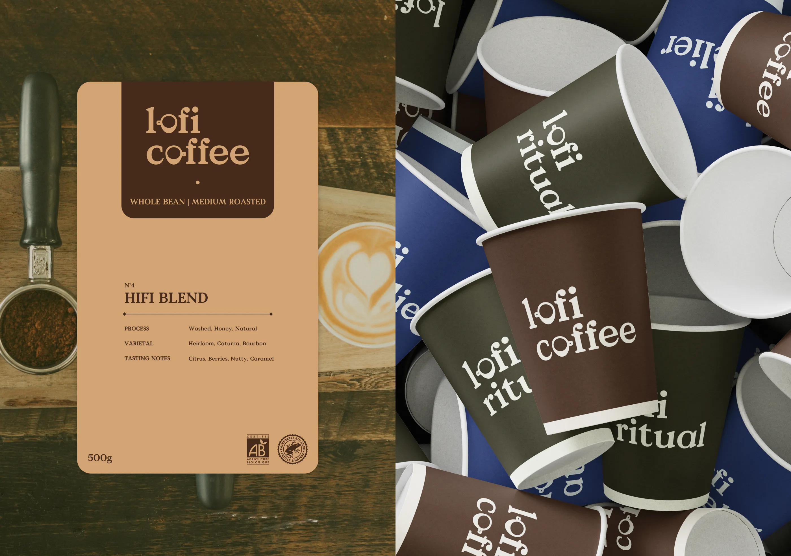

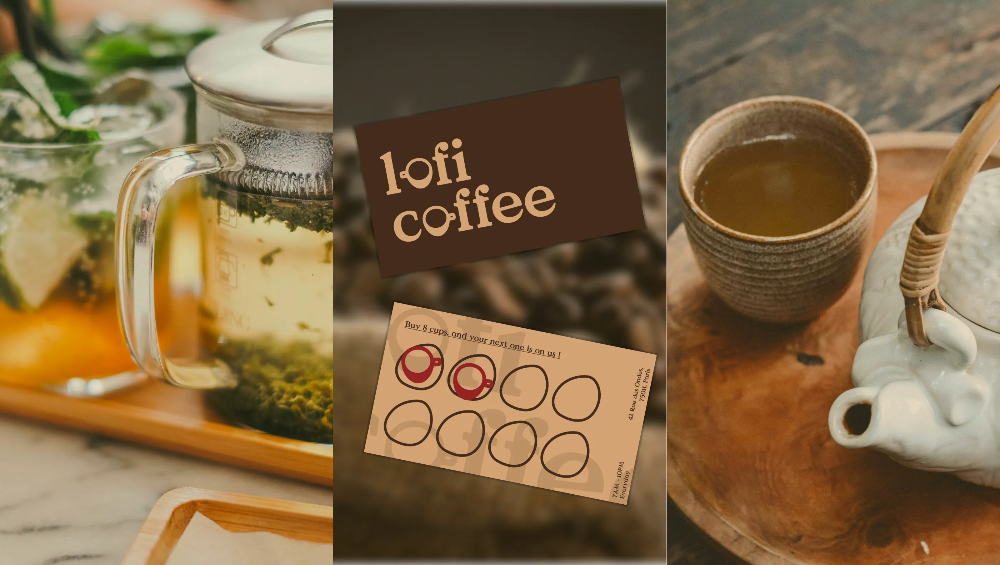

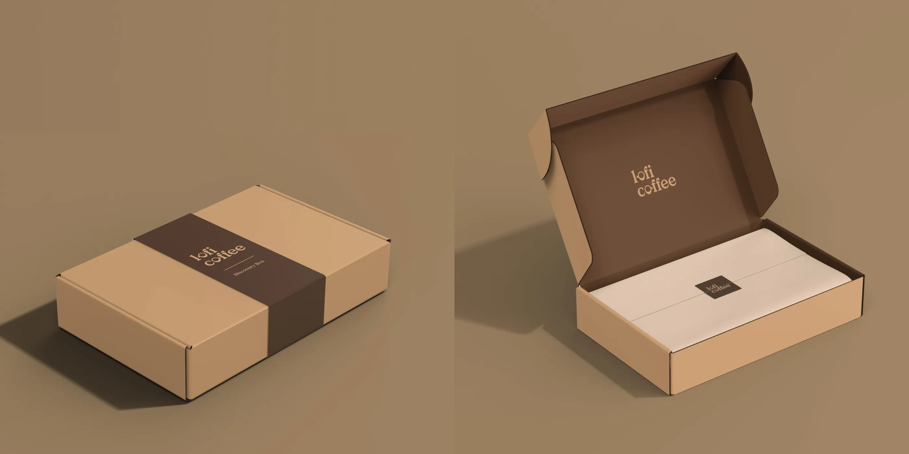
