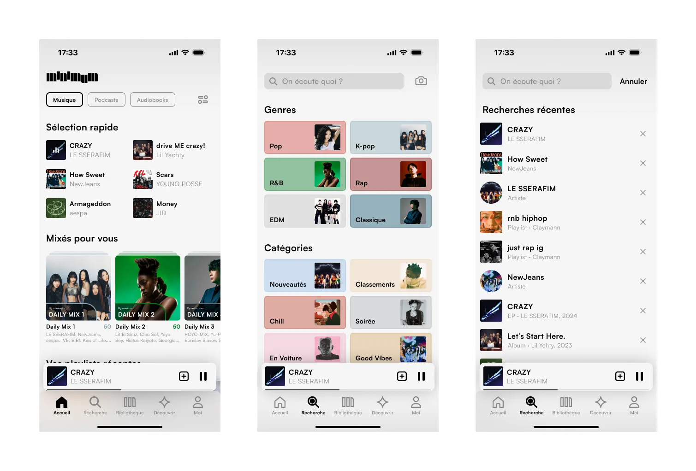
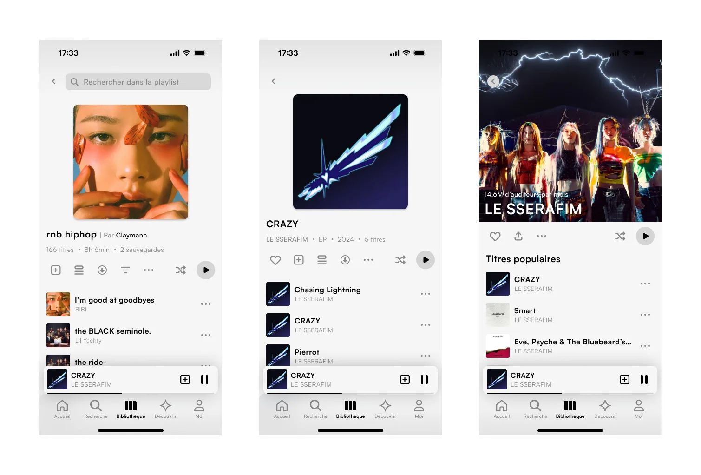
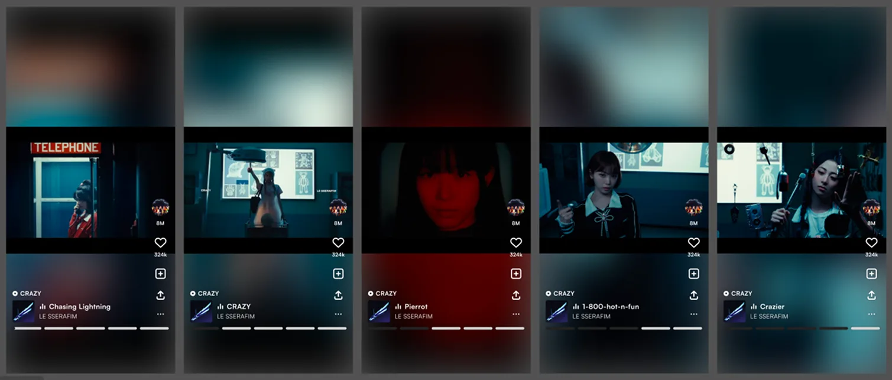
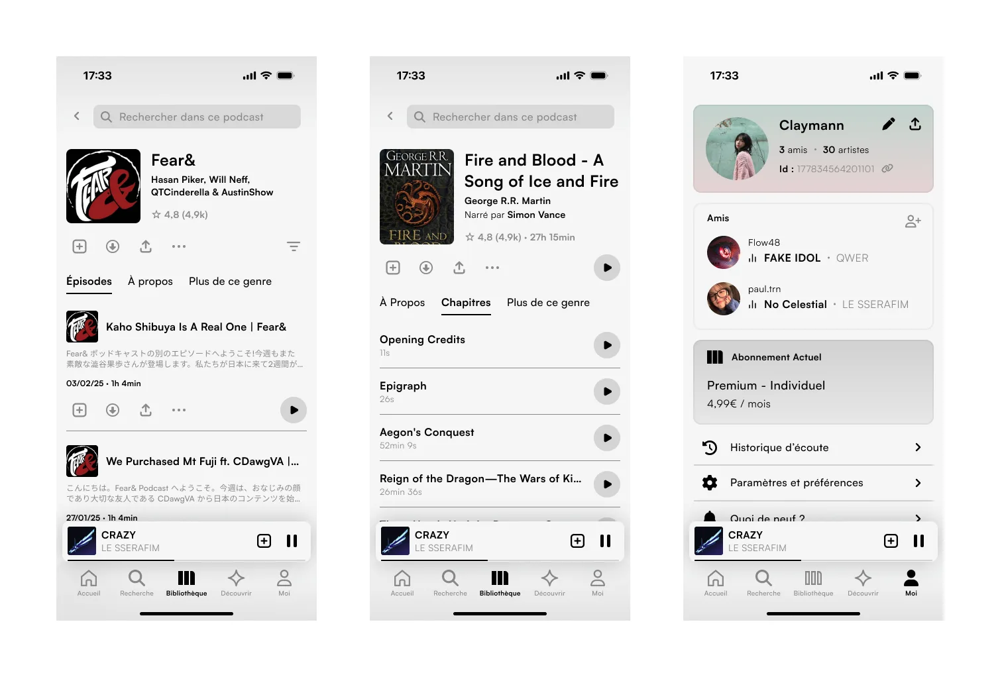

Aujourd'hui, les plateformes de streaming musical sont saturées de bannières promotionnelles, d'algorithmes invasifs et d'interfaces surchargées. Le concept de **minimum** part d'un constat simple : nous passons désormais plus de temps à naviguer, filtrer et subir des sollicitations visuelles qu'à apprécier la musique.

L'objectif de cette étude de cas a été de repenser l'expérience d'écoute de fond en comble. En supprimant le superflu et les distractions cognitives, minimum redonne toute sa primauté à l'œuvre sonore et propose un sanctuaire audio sobre, modulaire et hautement esthétique.

## 01. Une identité forgée par le rythme

Avant même de dessiner les premiers écrans, l'enjeu était d'ancrer le projet dans une identité graphique forte et évocatrice. Le logotype *minimum* a été construit à partir de variations verticales qui rappellent à la fois les barres d'un égaliseur de fréquences audio et les touches d'un clavier analogique.

Le monogramme « m » synthétise trois piliers architecturaux massifs dont le sommet s'adoucit d'une courbe précise. Travaillée en contraste absolu noir et blanc, l'identité visuelle affirme un positionnement intemporel et radical, pensé dès le départ pour vivre avec la même élégance en mode sombre qu'en mode clair.

## 02. Une navigation fluide et apaisée

L'architecture de l'application a été pensée pour éliminer la fatigue décisionnelle dès l'écran d'accueil. Les sélections rapides et les mix personnalisés sont directement accessibles sous forme de cartes synthétiques, sans carrousels interminables ni publicités déguisées.

Pour l'exploration par genres et catégories (Pop, K-pop, R&B, Chill...), le parti-pris chromatique s'éloigne des néons agressifs pour adopter des aplats doux et feutrés. Tout au long de la navigation, un mini-player en îlot flottant au bas de l'écran assure un contrôle immédiat de la lecture sans jamais encombrer l'espace.

## 03. L'album et l'artiste au premier plan

À l'ère de la consommation de singles éphémères, Minimum réhabilite la dimension artistique de l'album et le plaisir de parcourir une discographie. Les vues de playlists et d'EPs mettent en valeur les pochettes d'origine à travers une grille aérée, des métadonnées discrètes et une barre d'action intuitive (sauvegarde, téléchargement, ordre de lecture).

Sur les fiches artistes, l'interface s'efface au profit d'une immersion visuelle en pleine largeur, intégrant les statistiques d'écoute et les morceaux emblématiques dans une hiérarchie typographique fine et soignée.

## 04. Réinventer la découverte musicale

La section « Découvrir » propose une approche contemporaine de la recommandation. Plutôt qu'un flux passif de suggestions textuelles, l'utilisateur explore de nouveaux artistes à travers un flux vertical d'extraits vidéo et de boucles visuelles synchronisées.

Chaque carte génère dynamiquement un halo lumineux d'ambiance à partir des couleurs dominantes de la vidéo, créant un cocon immersif propre à chaque morceau. Une barre de progression segmentée et des interactions gestuelles minimalistes permettent de sauvegarder un coup de cœur en un geste tout en maintenant la continuité de l'écoute.

## 05. Un écosystème audio complet et social

L'expérience Minimum ne s'arrête pas à la musique : podcasts et livres audio s'intègrent naturellement sous la même grammaire visuelle. Les interfaces s'adaptent aux spécificités de ces formats longs grâce à un chapitrage clair, une gestion fluide des épisodes et une mémorisation précise de la lecture.

Enfin, l'espace profil « Moi » valorise une dimension communautaire respectueuse et bienveillante. L'activité d'écoute des proches y est partagée en temps réel sans transformer l'application en réseau social intrusif, favorisant la découverte spontanée et l'échange authentique entre passionnés.

